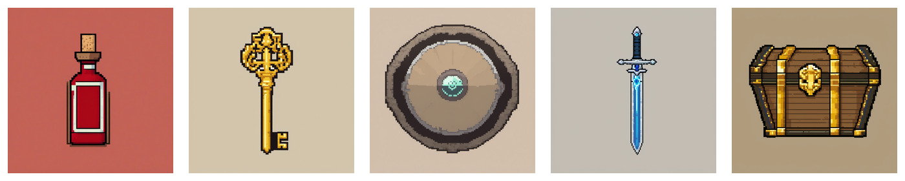
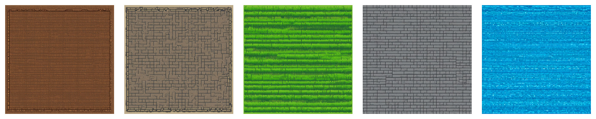
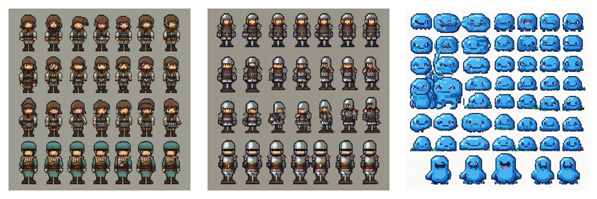

# SDXL 像素风游戏素材小样本报告

## 概览

本轮按小范围验证执行三条路线，不做大面积扩展：

| 套件 | 数量 | 目标 | 报告 |
|---|---:|---|---|
| `sdxl-pixel-item-icons` | 5 | 单体道具图标 | [报告](./sdxl-pixel-item-icons.md) |
| `sdxl-pixel-tile-textures` | 5 | 单体 tile / 材质纹理 | [报告](./sdxl-pixel-tile-textures.md) |
| `sdxl-pixel-sprite-sheets` | 3 | 小型 sprite sheet / 图集 | [报告](./sdxl-pixel-sprite-sheets.md) |

基础配置：

- 工作流：[sdxl-pixel-lora-t2i.api.json](../../configs/comfyui/workflows/sdxl-pixel-lora-t2i.api.json)
- checkpoint：`sdxl-base-1.0.safetensors`
- LoRA：`pixel-perfect-pony-sdxl.safetensors`
- LoRA 来源：[Tech-Meld/pixel-perfect-pony-sdxl](https://huggingface.co/Tech-Meld/pixel-perfect-pony-sdxl)
- 触发词：`PXLART`
- 生成尺寸：`1024x1024`
- seed：`42`
- 后处理：ImageMagick `point` / nearest-neighbor 缩放

注意：原计划第一候选 `Super_PixelArt_Sprite_XL_M_V1` 的 Civitai 下载接口在本机返回 `401`，本轮改用 Hugging Face 上可下载的 `pixel-perfect-pony-sdxl` 作为备选 LoRA。授权字段是 `other`，本轮只按本地研究验证处理，不给商用结论。

## 总览图

### 道具图标

### Tile 纹理

### Sprite Sheet

## 快速结论

### 单体道具图标

方向成立。5 个图标都能一眼识别，像素风明显，主体居中，背景简单。剑、钥匙、宝箱尤其适合继续做后处理；药水和盾牌也可用，但背景色和边缘后续需要统一。

本轮已经自动导出：

- raw：`1024x1024`
- processed：`128x128`
- preview：`512x512`

下一步如果继续这个方向，建议增加第二组道具并加入背景统一策略，比如固定浅灰底、纯色底或后处理抠图。

### Tile 纹理

方向部分成立。草地、石砖、水面、泥土、地牢墙地都有明确材质感，缩到 `64x64` / `128x128` 后可作为贴图草稿检查。

问题是：目前只能说明“像 tile texture”，不能说明“真正无缝 tile”。下一步需要加脚本做四边拼接检查，或者用 ComfyUI / 后处理流程强约束 seamless。

### Sprite Sheet

方向有探索价值，但不适合直接进入生产。模型没有严格服从“4 frames”的限制，实际生成了更多帧和多行布局；好处是角色和 slime 的风格一致性比预期好，说明 LoRA 对像素角色图集有一定帮助。

下一步如果继续 sprite sheet，必须引入更强布局控制：

- 固定网格模板
- 明确 cell 数量和边距
- 可能用参考图或 ControlNet 约束姿态
- 后处理切帧并生成 atlas manifest

## 本轮判断

优先继续 `item-icons`。它最稳定，最容易做成可复用资产链路。

推荐后续顺序：

1. `item-icons`：扩到 10-15 个道具，统一背景，测试透明/抠图
2. `tile-textures`：做无缝检查，不急着扩数量
3. `sprite-sheets`：等有模板/切帧脚本后再跑第二轮
