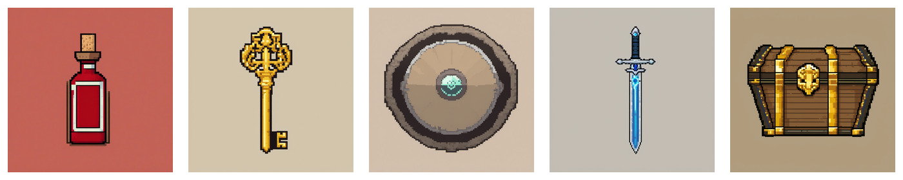

# sdxl-pixel-item-icons 测试报告

## 概览

- 运行入口：ComfyUI Desktop API
- API 地址：`http://127.0.0.1:8000`
- 工作流：[sdxl-pixel-lora-t2i.api.json](../../configs/comfyui/workflows/sdxl-pixel-lora-t2i.api.json)
- 参数文件：`sdxl-pixel-item-icons-seed42`
- 提示词套件：[sdxl-pixel-item-icons.yaml](../input/prompts/built-in/sdxl-pixel-item-icons.yaml)
- 模型：`sdxl-base-1.0.safetensors`
- LoRA：`pixel-perfect-pony-sdxl.safetensors`
- LoRA 强度：model `0.8` / clip `0.8`
- 尺寸：`1024x1024`
- steps：`24`
- CFG：`6.0`
- seed：`42`
- manifest：[manifest.json](../outputs/comfyui/built-in/sdxl-pixel-item-icons/manifest.json)

## 生成结果

| 用例 | 中文 | 耗时 | 原图 | 处理后 | SHA256 |
|---|---|---:|---|---|---|
| `sword` | 长剑 | `45.04s` | [图片](../outputs/comfyui/built-in/sdxl-pixel-item-icons/raw/sword-seed42.png) | [sword.png](../outputs/comfyui/built-in/sdxl-pixel-item-icons/processed/128x128/sword.png) [sword-128x-preview.png](../outputs/comfyui/built-in/sdxl-pixel-item-icons/processed/preview-512/sword-128x-preview.png) | `c8dbb4df63a20e972d93bd7b66a6d32530e99cafbd93986aad3e7c888331eaec` |
| `health-potion` | 生命药水 | `50.03s` | [图片](../outputs/comfyui/built-in/sdxl-pixel-item-icons/raw/health-potion-seed42.png) | [health-potion.png](../outputs/comfyui/built-in/sdxl-pixel-item-icons/processed/128x128/health-potion.png) [health-potion-128x-preview.png](../outputs/comfyui/built-in/sdxl-pixel-item-icons/processed/preview-512/health-potion-128x-preview.png) | `edbedd06220b19f650875544b4df9a08b3fa27ac67cc88d4b52d9437eda84065` |
| `shield` | 盾牌 | `85.04s` | [图片](../outputs/comfyui/built-in/sdxl-pixel-item-icons/raw/shield-seed42.png) | [shield.png](../outputs/comfyui/built-in/sdxl-pixel-item-icons/processed/128x128/shield.png) [shield-128x-preview.png](../outputs/comfyui/built-in/sdxl-pixel-item-icons/processed/preview-512/shield-128x-preview.png) | `7a47fc0685a93a72b55d45b185f8609c67c3283427a081cd8a01bdb9bfbcb43d` |
| `treasure-chest` | 宝箱 | `110.05s` | [图片](../outputs/comfyui/built-in/sdxl-pixel-item-icons/raw/treasure-chest-seed42.png) | [treasure-chest.png](../outputs/comfyui/built-in/sdxl-pixel-item-icons/processed/128x128/treasure-chest.png) [treasure-chest-128x-preview.png](../outputs/comfyui/built-in/sdxl-pixel-item-icons/processed/preview-512/treasure-chest-128x-preview.png) | `6843d5c2d334d3288f44a067e5d4321f2f5648284f7df428defa7bd47eb72cf0` |
| `key` | 钥匙 | `90.04s` | [图片](../outputs/comfyui/built-in/sdxl-pixel-item-icons/raw/key-seed42.png) | [key.png](../outputs/comfyui/built-in/sdxl-pixel-item-icons/processed/128x128/key.png) [key-128x-preview.png](../outputs/comfyui/built-in/sdxl-pixel-item-icons/processed/preview-512/key-128x-preview.png) | `3cae5b9a28a3ce5d6504dee01862b81f144044c88b313ca6802eaec51b80701e` |

## 预览

### sword

### health-potion

### shield

### treasure-chest

### key

## 快速观察

- 5 个道具都能一眼识别，单体道具图标方向成立
- 剑、钥匙、宝箱最稳定，轮廓干净，适合继续做透明/统一背景测试
- 药水和盾牌也可用，但背景色和边缘后续需要统一
- 透明背景不作为本轮验收条件，本轮主要看像素风、轮廓、可识别性和单体路线是否成立
