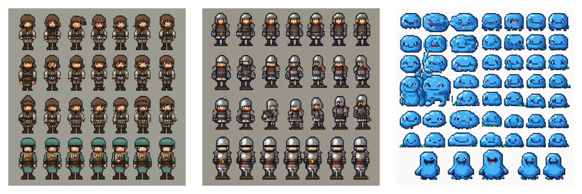

# sdxl-pixel-sprite-sheets 测试报告

## 概览

- 运行入口：ComfyUI Desktop API
- API 地址：`http://127.0.0.1:8000`
- 工作流：[sdxl-pixel-lora-t2i.api.json](../../configs/comfyui/workflows/sdxl-pixel-lora-t2i.api.json)
- 参数文件：`sdxl-pixel-sprite-sheets-seed42`
- 提示词套件：[sdxl-pixel-sprite-sheets.yaml](../input/prompts/built-in/sdxl-pixel-sprite-sheets.yaml)
- 模型：`sdxl-base-1.0.safetensors`
- LoRA：`pixel-perfect-pony-sdxl.safetensors`
- LoRA 强度：model `0.9` / clip `0.9`
- 尺寸：`1024x1024`
- steps：`28`
- CFG：`6.0`
- seed：`42`
- manifest：[manifest.json](../outputs/comfyui/built-in/sdxl-pixel-sprite-sheets/manifest.json)

## 生成结果

| 用例 | 中文 | 耗时 | 原图 | 处理后 | SHA256 |
|---|---|---:|---|---|---|
| `adventurer-idle` | 冒险者待机 | `90.04s` | [图片](../outputs/comfyui/built-in/sdxl-pixel-sprite-sheets/raw/adventurer-idle-seed42.png) | - | `d0097397e5bfb614a293e8707810667b09666d6d974816cb81f25957a1e8c4d4` |
| `slime-bounce` | 史莱姆弹跳 | `85.04s` | [图片](../outputs/comfyui/built-in/sdxl-pixel-sprite-sheets/raw/slime-bounce-seed42.png) | - | `85aae53f81ce2a4dce092f7bf43759704bfb60d6287b7f335e72153b41c05c24` |
| `knight-walk` | 骑士行走 | `80.05s` | [图片](../outputs/comfyui/built-in/sdxl-pixel-sprite-sheets/raw/knight-walk-seed42.png) | - | `cbf096f9b511a0413a3bcaf31e4552496d8728a1f4a69314eb65b27d7a287ffb` |

## 预览

### adventurer-idle

### slime-bounce

### knight-walk

## 快速观察

- 图集方向有探索价值，但还不能直接生产使用
- 模型没有严格服从 `4 frames`，实际倾向生成多行多帧 sprite sheet
- 角色和 slime 的风格一致性比预期好，说明 LoRA 对像素角色图集有帮助
- 下一轮 sprite sheet 必须增加固定网格模板、切帧脚本和 atlas manifest
