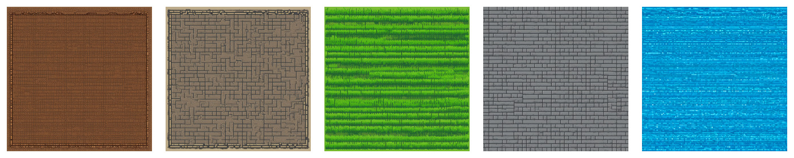

# sdxl-pixel-tile-textures 测试报告

## 概览

- 运行入口：ComfyUI Desktop API
- API 地址：`http://127.0.0.1:8000`
- 工作流：[sdxl-pixel-lora-t2i.api.json](../../configs/comfyui/workflows/sdxl-pixel-lora-t2i.api.json)
- 参数文件：`sdxl-pixel-tile-textures-seed42`
- 提示词套件：[sdxl-pixel-tile-textures.yaml](../input/prompts/built-in/sdxl-pixel-tile-textures.yaml)
- 模型：`sdxl-base-1.0.safetensors`
- LoRA：`pixel-perfect-pony-sdxl.safetensors`
- LoRA 强度：model `0.8` / clip `0.8`
- 尺寸：`1024x1024`
- steps：`24`
- CFG：`6.0`
- seed：`42`
- manifest：[manifest.json](../outputs/comfyui/built-in/sdxl-pixel-tile-textures/manifest.json)

## 生成结果

| 用例 | 中文 | 耗时 | 原图 | 处理后 | SHA256 |
|---|---|---:|---|---|---|
| `grass` | 草地 | `100.04s` | [图片](../outputs/comfyui/built-in/sdxl-pixel-tile-textures/raw/grass-seed42.png) | [grass.png](../outputs/comfyui/built-in/sdxl-pixel-tile-textures/processed/64x64/grass.png) [grass-64x-preview.png](../outputs/comfyui/built-in/sdxl-pixel-tile-textures/processed/preview-512/grass-64x-preview.png) [grass.png](../outputs/comfyui/built-in/sdxl-pixel-tile-textures/processed/128x128/grass.png) [grass-128x-preview.png](../outputs/comfyui/built-in/sdxl-pixel-tile-textures/processed/preview-512/grass-128x-preview.png) | `74c5c53a6852db753caa5137dcb5b4a6646d4d88f63f85a966f8772dab5ea4b5` |
| `stone-floor` | 石砖地面 | `105.06s` | [图片](../outputs/comfyui/built-in/sdxl-pixel-tile-textures/raw/stone-floor-seed42.png) | [stone-floor.png](../outputs/comfyui/built-in/sdxl-pixel-tile-textures/processed/64x64/stone-floor.png) [stone-floor-64x-preview.png](../outputs/comfyui/built-in/sdxl-pixel-tile-textures/processed/preview-512/stone-floor-64x-preview.png) [stone-floor.png](../outputs/comfyui/built-in/sdxl-pixel-tile-textures/processed/128x128/stone-floor.png) [stone-floor-128x-preview.png](../outputs/comfyui/built-in/sdxl-pixel-tile-textures/processed/preview-512/stone-floor-128x-preview.png) | `a19be0b09469f320bce739457f24885702ed597dc150d110b1f6f4748a552469` |
| `water` | 水面 | `105.07s` | [图片](../outputs/comfyui/built-in/sdxl-pixel-tile-textures/raw/water-seed42.png) | [water.png](../outputs/comfyui/built-in/sdxl-pixel-tile-textures/processed/64x64/water.png) [water-64x-preview.png](../outputs/comfyui/built-in/sdxl-pixel-tile-textures/processed/preview-512/water-64x-preview.png) [water.png](../outputs/comfyui/built-in/sdxl-pixel-tile-textures/processed/128x128/water.png) [water-128x-preview.png](../outputs/comfyui/built-in/sdxl-pixel-tile-textures/processed/preview-512/water-128x-preview.png) | `ae90c6e8115fce956fb3a26ebd3bcbd6f2fc9d5ce259d0989c952f3bc9192978` |
| `dirt` | 泥土地面 | `95.05s` | [图片](../outputs/comfyui/built-in/sdxl-pixel-tile-textures/raw/dirt-seed42.png) | [dirt.png](../outputs/comfyui/built-in/sdxl-pixel-tile-textures/processed/64x64/dirt.png) [dirt-64x-preview.png](../outputs/comfyui/built-in/sdxl-pixel-tile-textures/processed/preview-512/dirt-64x-preview.png) [dirt.png](../outputs/comfyui/built-in/sdxl-pixel-tile-textures/processed/128x128/dirt.png) [dirt-128x-preview.png](../outputs/comfyui/built-in/sdxl-pixel-tile-textures/processed/preview-512/dirt-128x-preview.png) | `3663d73f0e2b37125e85158e4cdd61ea3a3e0720af38d947584edf4243dd0cd7` |
| `dungeon-wall-floor` | 地牢墙地 | `85.04s` | [图片](../outputs/comfyui/built-in/sdxl-pixel-tile-textures/raw/dungeon-wall-floor-seed42.png) | [dungeon-wall-floor.png](../outputs/comfyui/built-in/sdxl-pixel-tile-textures/processed/64x64/dungeon-wall-floor.png) [dungeon-wall-floor-64x-preview.png](../outputs/comfyui/built-in/sdxl-pixel-tile-textures/processed/preview-512/dungeon-wall-floor-64x-preview.png) [dungeon-wall-floor.png](../outputs/comfyui/built-in/sdxl-pixel-tile-textures/processed/128x128/dungeon-wall-floor.png) [dungeon-wall-floor-128x-preview.png](../outputs/comfyui/built-in/sdxl-pixel-tile-textures/processed/preview-512/dungeon-wall-floor-128x-preview.png) | `0b062f702187d8f97a06b7a053bd68acc7c264bf810a254f9e0dcf8d45f00758` |

## 预览

### grass

### stone-floor

### water

### dirt

### dungeon-wall-floor

## 快速观察

- 5 个材质都有明确 tile texture 视觉，草地、石砖、水面最清楚
- 本轮只能证明“像 tile”，不能证明“无缝 tile”
- 后续需要做四边拼接检查或引入 seamless workflow，再决定是否扩数量
- 本轮已导出 `64x64` 和 `128x128` 两组处理版本，方便对比资产尺寸
