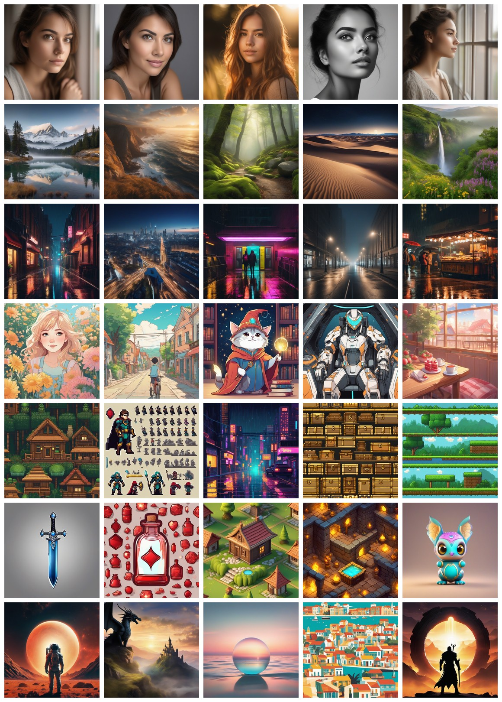

# SDXL 主题套件测试报告

## 概览

- 目标：按用户指定的 7 个主题做更清晰的 SDXL base 覆盖测试
- 主题：清晰人像、风景、城市夜景、卡通动漫、像素风格、游戏素材、海报封面
- 数量：每个主题 5 张，共 35 张
- 模型：`sdxl-base-1.0.safetensors`
- 工作流：[sdxl-basic-t2i.api.json](../../configs/comfyui/workflows/sdxl-basic-t2i.api.json)
- 参数文件：[sdxl-theme-suite.seed42.yaml](../../configs/comfyui/params/built-in/sdxl-theme-suite.seed42.yaml)
- 提示词套件：[sdxl-theme-suite.yaml](../input/prompts/built-in/sdxl-theme-suite.yaml)
- 运行 manifest：[sdxl-theme-suite-seed42-2026-05-21.json](../outputs/comfyui/built-in/sdxl-theme-suite/sdxl-theme-suite-seed42-2026-05-21.json)
- contact sheet：[总览图](../outputs/reports/contact-sheets/sdxl-theme-suite-contact-sheet.jpg)

## 参数

| 参数 | 值 |
|---|---:|
| 分辨率 | `1024x1024` |
| steps | `24` |
| CFG | `6.5` |
| sampler | `euler` |
| scheduler | `normal` |
| denoise | `1.0` |
| batch size | `1` |
| seed | `42` |

## 执行状态

- 执行前系统内存：`49.04 GiB / 64.00 GiB`
- swap：disabled
- `memory_pressure`：`System-wide memory free percentage: 68%`
- ComfyUI API 执行前可用内存约 `23.45 GiB`
- 执行后 ComfyUI API 可用内存约 `25.26 GiB`
- 总耗时约：`50.4 分钟`
- 平均每张约：`86.5s`

## 总览图

## 主题结果
### 清晰人像 `clear-portrait`

目标：测试脸部结构、眼睛、皮肤质感、自然光、景深和商业摄影感

| 用例 | 耗时 | 可用内存变化 | 输出 | SHA256 |
|---|---:|---:|---|---|
| `clear-portrait-window-light` | `45.1s` | `23.31 -> 19.48 GiB` | [图片](../outputs/comfyui/built-in/sdxl-theme-suite/clear-portrait/clear-portrait-window-light-seed42.png) | `9740bf6407d1415e2855f3251165013949faa8ac49793fada47ac5c18016f2a7` |
| `clear-portrait-studio-softbox` | `105.07s` | `19.46 -> 26.33 GiB` | [图片](../outputs/comfyui/built-in/sdxl-theme-suite/clear-portrait/clear-portrait-studio-softbox-seed42.png) | `6bc24bea340c560a0788a6aa233e116f5eb618917370a362ac5611aa019c31c8` |
| `clear-portrait-golden-hour` | `145.08s` | `26.33 -> 25.83 GiB` | [图片](../outputs/comfyui/built-in/sdxl-theme-suite/clear-portrait/clear-portrait-golden-hour-seed42.png) | `2a5a6c5865cbe1f0b9dda4214883a6f69a8f025d8ad90b979622102c679376c4` |
| `clear-portrait-black-white` | `120.08s` | `25.83 -> 25.8 GiB` | [图片](../outputs/comfyui/built-in/sdxl-theme-suite/clear-portrait/clear-portrait-black-white-seed42.png) | `64a5c0b7eb04fb11a43ee53a5a7aea4fc969a722d2bd53029d0ae375aeff1c7f` |
| `clear-portrait-profile` | `105.05s` | `25.8 -> 25 GiB` | [图片](../outputs/comfyui/built-in/sdxl-theme-suite/clear-portrait/clear-portrait-profile-seed42.png) | `0cce9144b3348f193107d01777fbbd89dffb7fcd606991162abe3929c0e922c3` |

预览：

观察：人像整体稳定，脸部结构清晰，眼睛和自然光表现较好；但人物脸型有一定相似性，后续如果要做角色一致性或特定人物，需要单独方法

### 风景 `landscape`

目标：测试自然大场景、远近层次、天空、水面、山体和氛围

| 用例 | 耗时 | 可用内存变化 | 输出 | SHA256 |
|---|---:|---:|---|---|
| `landscape-alpine-lake` | `100.06s` | `25 -> 25.98 GiB` | [图片](../outputs/comfyui/built-in/sdxl-theme-suite/landscape/landscape-alpine-lake-seed42.png) | `3e2bbe2dbe552a612b594671e621b3309abcfdc5de93fe43451ac02bf0642c32` |
| `landscape-coastal-cliff` | `105.06s` | `25.98 -> 24.47 GiB` | [图片](../outputs/comfyui/built-in/sdxl-theme-suite/landscape/landscape-coastal-cliff-seed42.png) | `74a05f1bed1b5cd06063fece9e3645869027e9848283062e3260278171a05001` |
| `landscape-forest-trail` | `90.05s` | `24.48 -> 25.34 GiB` | [图片](../outputs/comfyui/built-in/sdxl-theme-suite/landscape/landscape-forest-trail-seed42.png) | `b932829b298033a0fdb89df8202b4089988b9189a7fc3fc3c9db3451c78ceb5d` |
| `landscape-desert-dunes` | `85.05s` | `25.34 -> 23.71 GiB` | [图片](../outputs/comfyui/built-in/sdxl-theme-suite/landscape/landscape-desert-dunes-seed42.png) | `1bcaa9b1d37130dfcba2d7736a3181e27ec525772ab209e3dc4a3450b79f4335` |
| `landscape-waterfall-valley` | `80.04s` | `23.71 -> 23.64 GiB` | [图片](../outputs/comfyui/built-in/sdxl-theme-suite/landscape/landscape-waterfall-valley-seed42.png) | `0cfcb114458d8849f00fd3c988e6f8092e26495b7dcd76e49a199a9abc830f22` |

预览：

观察：风景主题表现稳定，湖泊、海岸、森林、沙漠、瀑布都有明确场景层次；这类题材适合作为 SDXL base 的强项 baseline

### 城市夜景 `city-night`

目标：测试夜景、霓虹、反射、街道透视、建筑光源和伪文字问题

| 用例 | 耗时 | 可用内存变化 | 输出 | SHA256 |
|---|---:|---:|---|---|
| `city-night-rainy-alley` | `85.05s` | `23.63 -> 25.09 GiB` | [图片](../outputs/comfyui/built-in/sdxl-theme-suite/city-night/city-night-rainy-alley-seed42.png) | `06b5a699176aca39583af51a5f1e42d25d5ee9b3c47cb4777866372fe5dfdaf8` |
| `city-night-rooftop-skyline` | `80.04s` | `25.09 -> 18.63 GiB` | [图片](../outputs/comfyui/built-in/sdxl-theme-suite/city-night/city-night-rooftop-skyline-seed42.png) | `05887c61c802ec00dbc1bc4a1413e392c11d4856fedf7bb9ede4a40ae9537d31` |
| `city-night-subway-entrance` | `85.04s` | `18.67 -> 25.02 GiB` | [图片](../outputs/comfyui/built-in/sdxl-theme-suite/city-night/city-night-subway-entrance-seed42.png) | `0df4cf3b346fd9cc2b3e939f83e351f8f9ed8742151804b6a5ba3e1188a3d531` |
| `city-night-empty-street` | `85.04s` | `25.02 -> 24.03 GiB` | [图片](../outputs/comfyui/built-in/sdxl-theme-suite/city-night/city-night-empty-street-seed42.png) | `3644348f9023a5afedbb3b0d49dfac1091d4958706622028d739ad419e9e0736` |
| `city-night-food-stall` | `85.04s` | `24.03 -> 25.14 GiB` | [图片](../outputs/comfyui/built-in/sdxl-theme-suite/city-night/city-night-food-stall-seed42.png) | `4802b78704af1bc4609a8698ef3df6f0f386d96dae0a0e19a4ce923d66d0eaf1` |

预览：

观察：夜景、雨地反射、霓虹气氛较好；但城市招牌容易出现伪文字，后续需要加强 negative prompt 或避免近距离文字牌

### 卡通动漫 `cartoon-anime`

目标：测试非写实角色、线条、色彩、动画感和风格一致性

| 用例 | 耗时 | 可用内存变化 | 输出 | SHA256 |
|---|---:|---:|---|---|
| `cartoon-anime-girl-garden` | `85.03s` | `25.14 -> 25.42 GiB` | [图片](../outputs/comfyui/built-in/sdxl-theme-suite/cartoon-anime/cartoon-anime-girl-garden-seed42.png) | `701aec08588f846f342ae4aef4c91af1de9198ecd64795d303f57b7545ce61ce` |
| `cartoon-anime-boy-bike` | `85.04s` | `25.42 -> 24.7 GiB` | [图片](../outputs/comfyui/built-in/sdxl-theme-suite/cartoon-anime/cartoon-anime-boy-bike-seed42.png) | `f9a82575b396d885a72911db2f5fc06fb25abb06a3c88d51b2cf4aed9366521d` |
| `cartoon-anime-cat-wizard` | `90.04s` | `24.7 -> 24.22 GiB` | [图片](../outputs/comfyui/built-in/sdxl-theme-suite/cartoon-anime/cartoon-anime-cat-wizard-seed42.png) | `05c9ded9f06be93880d17c2a2f04fdb501e466d3e6f3436da8e58dad5f119e8e` |
| `cartoon-anime-mecha-pilot` | `90.04s` | `24.22 -> 25.07 GiB` | [图片](../outputs/comfyui/built-in/sdxl-theme-suite/cartoon-anime/cartoon-anime-mecha-pilot-seed42.png) | `19e1ccc2f12ec7f5053dd12f96c486898c60f69ef6626214e79968ac27364bd0` |
| `cartoon-anime-food-cafe` | `90.05s` | `25.07 -> 25.24 GiB` | [图片](../outputs/comfyui/built-in/sdxl-theme-suite/cartoon-anime/cartoon-anime-food-cafe-seed42.png) | `fc2013910c62f9d7594c1df48d848ba9b98760ab06ed74c7ecf24a2278c4f752` |

预览：

观察：卡通动漫风格整体可用，色彩和线条感明显；严格日系角色一致性不是 base 模型强项，后续可以考虑 LoRA

### 像素风格 `pixel-art`

目标：测试 SDXL base 对 pixel art、8-bit、16-bit、低分辨率风格的理解；严格像素格可能需要 LoRA

| 用例 | 耗时 | 可用内存变化 | 输出 | SHA256 |
|---|---:|---:|---|---|
| `pixel-art-forest-cabin` | `95.06s` | `25.24 -> 26.01 GiB` | [图片](../outputs/comfyui/built-in/sdxl-theme-suite/pixel-art/pixel-art-forest-cabin-seed42.png) | `bf4ab40a17781280e1734bd06b8cc2680ced485326379fe8e2ccb9df3b561675` |
| `pixel-art-hero-idle` | `90.06s` | `25.93 -> 25.33 GiB` | [图片](../outputs/comfyui/built-in/sdxl-theme-suite/pixel-art/pixel-art-hero-idle-seed42.png) | `4aa36dcc7de687d3bf9a01390780a2f1eebf99c4d93dd60ead3f6ab8481febb6` |
| `pixel-art-city-rain` | `95.05s` | `25.33 -> 25.63 GiB` | [图片](../outputs/comfyui/built-in/sdxl-theme-suite/pixel-art/pixel-art-city-rain-seed42.png) | `436dd24fd5a7fd10c78806de7ea5b33f144d0ea2b9d4a9db242a36cf885178b4` |
| `pixel-art-treasure-chest` | `75.04s` | `25.63 -> 24.64 GiB` | [图片](../outputs/comfyui/built-in/sdxl-theme-suite/pixel-art/pixel-art-treasure-chest-seed42.png) | `0c743819dc1975942e44cd436d0d99d002561ac9ca3eb4dc43793990d58b7e20` |
| `pixel-art-platformer-level` | `75.04s` | `24.64 -> 25.85 GiB` | [图片](../outputs/comfyui/built-in/sdxl-theme-suite/pixel-art/pixel-art-platformer-level-seed42.png) | `240484da3c054f408a812cac5290a393ce4c0187dc7b237a63e2fcf52b52f2bb` |

预览：

观察：像素主题能生成像素风视觉，但并非所有图都是真正严格像素格；角色 idle 变成了 sprite sheet，说明 SDXL base 会自行扩展“游戏素材”语义

### 游戏素材 `game-assets`

目标：测试道具、图标、角色资产、等距场景和可复用素材感

| 用例 | 耗时 | 可用内存变化 | 输出 | SHA256 |
|---|---:|---:|---|---|
| `game-asset-sword-icon` | `75.04s` | `25.85 -> 25.86 GiB` | [图片](../outputs/comfyui/built-in/sdxl-theme-suite/game-assets/game-asset-sword-icon-seed42.png) | `b15aed6848a4f658bc5cf08b563eae5dd0e597e3209f130421320955209ce639` |
| `game-asset-potion-bottle` | `75.05s` | `25.86 -> 25.91 GiB` | [图片](../outputs/comfyui/built-in/sdxl-theme-suite/game-assets/game-asset-potion-bottle-seed42.png) | `3b763eee541316e7c7218a360d6c88bd3b00c2db78213d5a81a1ec3f6e006d6e` |
| `game-asset-isometric-house` | `75.04s` | `25.91 -> 26.49 GiB` | [图片](../outputs/comfyui/built-in/sdxl-theme-suite/game-assets/game-asset-isometric-house-seed42.png) | `d17c42b9905cb5c17d38efa3a1fd22a72dec8398680f8adc4c55221bdc2c4e03` |
| `game-asset-treasure-room` | `75.05s` | `26.49 -> 25.96 GiB` | [图片](../outputs/comfyui/built-in/sdxl-theme-suite/game-assets/game-asset-treasure-room-seed42.png) | `7d6e5761dee26f747e1eb2892cd4221da37033446be3ec85bb6d5e6b4827eade` |
| `game-asset-creature-companion` | `70.17s` | `25.96 -> 19.05 GiB` | [图片](../outputs/comfyui/built-in/sdxl-theme-suite/game-assets/game-asset-creature-companion-seed42.png) | `19bfd060d930ad6bf8c4066a4fa5cde6b0b0a7628bf1732274ba1d3d32af655e` |

预览：

观察：游戏素材整体可用，剑、药水、等距房屋、房间、伙伴角色都能形成清晰素材感；药水图生成了多图标集合，不是单一物体

### 海报封面 `poster-cover`

目标：测试主视觉、画面层级、封面构图和图形感；不要求真实可读文字

| 用例 | 耗时 | 可用内存变化 | 输出 | SHA256 |
|---|---:|---:|---|---|
| `poster-cover-sci-fi-film` | `75.04s` | `19.02 -> 25.08 GiB` | [图片](../outputs/comfyui/built-in/sdxl-theme-suite/poster-cover/poster-cover-sci-fi-film-seed42.png) | `17d9204a70a8adff703462b131ce96f2dddab47d20b603f7d235868b28957c55` |
| `poster-cover-fantasy-book` | `75.05s` | `25.08 -> 24.65 GiB` | [图片](../outputs/comfyui/built-in/sdxl-theme-suite/poster-cover/poster-cover-fantasy-book-seed42.png) | `c220ef0556dcdb3001ce26e33c85a3aa7450ef44be1ec18db94fb91adb58711e` |
| `poster-cover-music-album` | `80.04s` | `24.65 -> 25.15 GiB` | [图片](../outputs/comfyui/built-in/sdxl-theme-suite/poster-cover/poster-cover-music-album-seed42.png) | `bff72cc1ce11a48531ccf70a2e9363426dd0cdc30f366063453e40fb111267ca` |
| `poster-cover-travel` | `80.05s` | `25.15 -> 25.18 GiB` | [图片](../outputs/comfyui/built-in/sdxl-theme-suite/poster-cover/poster-cover-travel-seed42.png) | `6b0f9c21f9756b64e3da618e77c74f819fb6323934ff92acc3c9eb87f4395ce7` |
| `poster-cover-game-launch` | `75.05s` | `25.18 -> 25.87 GiB` | [图片](../outputs/comfyui/built-in/sdxl-theme-suite/poster-cover/poster-cover-game-launch-seed42.png) | `4ee85cdabad9819f98a610f3f1d143d99143dd4645682883ba6d8fcb0d9bd2a5` |

预览：

观察：海报封面构图和主视觉较强，适合做 key art；文字仍然不应该依赖 SDXL base 直接生成

## 初步结论

- SDXL base 1.0 对人像、风景、城市夜景、卡通插画、游戏 key art 的基础质量是可用的
- 像素风格能做出“像素感”，但严格像素资产不稳定，后续大概率需要 pixel art LoRA 或专用 workflow
- 游戏素材方向可继续深挖，但要把“单物体 icon”和“素材集合 / sprite sheet”分开写 prompt
- 海报封面可以生成主视觉，但不应该让 SDXL base 负责真实文字排版
- 下一轮建议先让用户验收这 35 张，再决定是否对某个主题扩 seed 或调 CFG
